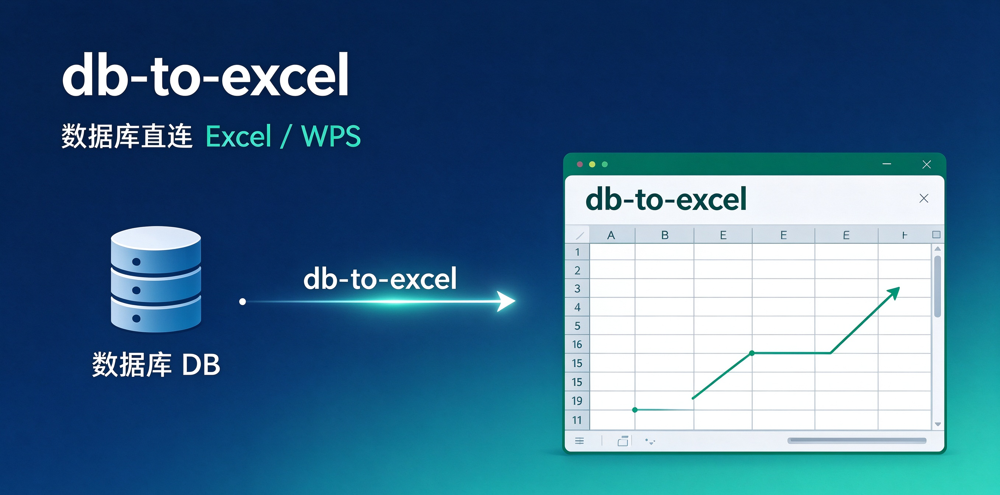
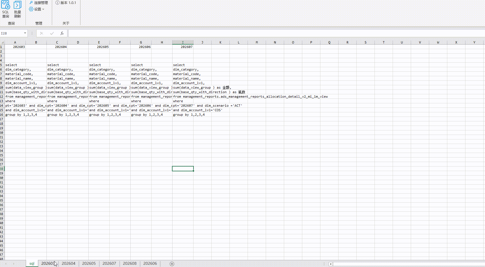
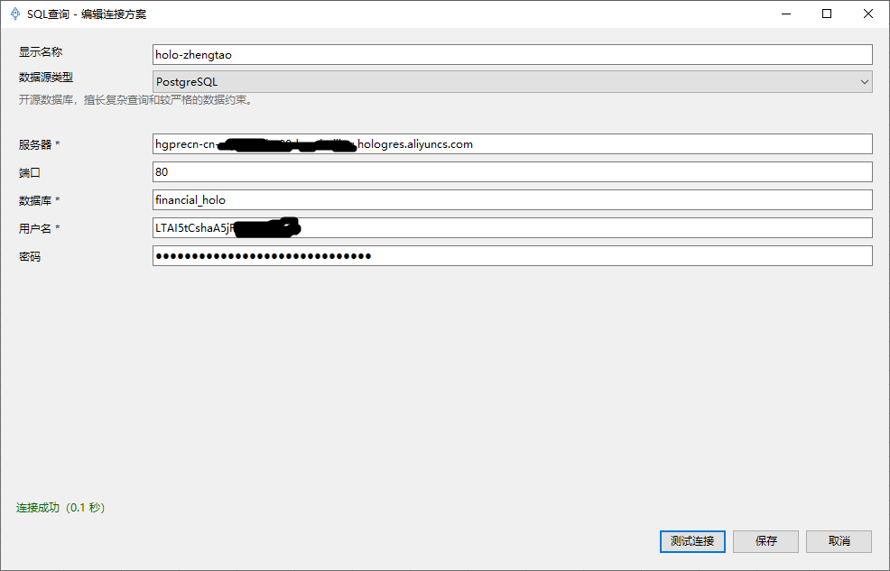
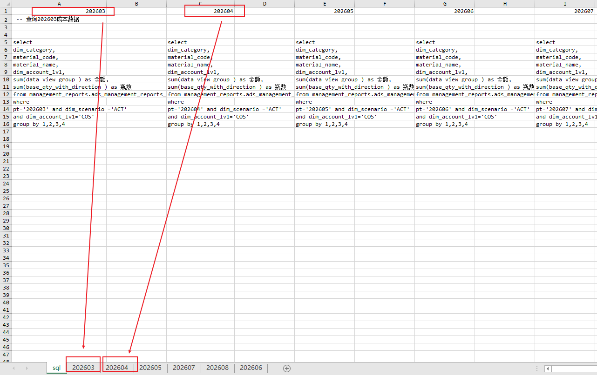
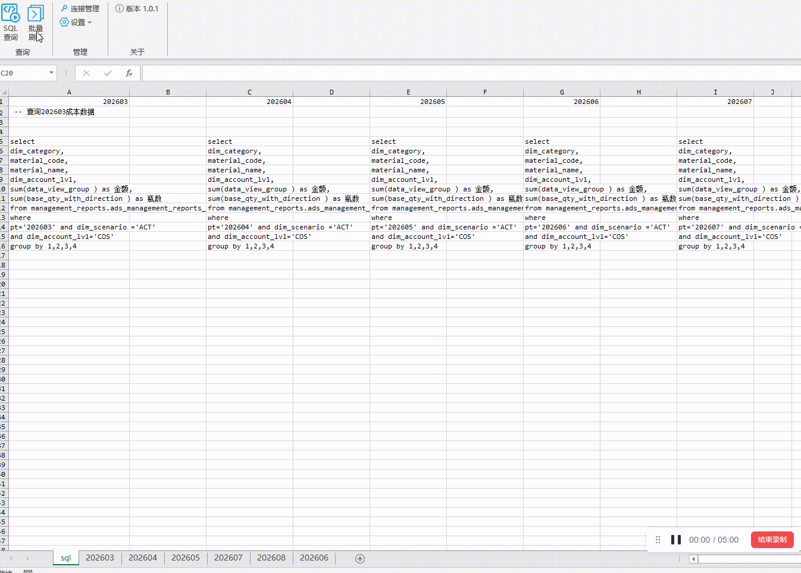
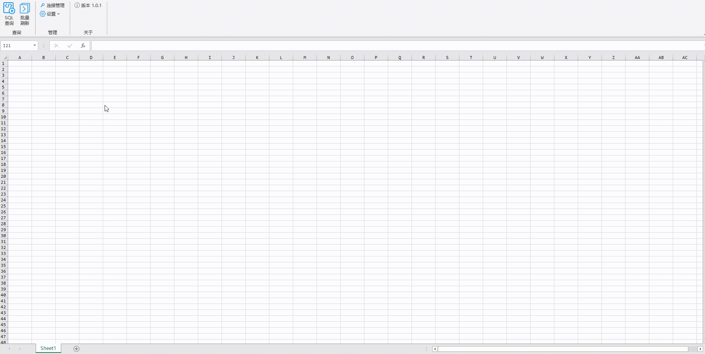

**🔥 痛点**

数分和报表岗日常最枯燥的重复劳动：打开 DBeaver/Navicat → 跑 SQL → 导出结果 → 复制粘贴进 Excel，当Excel底稿涉及多个 Sheet更新时，搬运数据的耗时尤其巨大。

**⚡ db-to-excel 是什么**

db-to-excel 是嵌入 Windows  Excel / WPS 表格的插件，在表格内部直接执行 SQL，把数据库查询结果写入工作表。插件只负责【数据库到工作表的数据同步】，保留原有的 Excel 生态：公式、透视表、图表、看板不需重构。定期报表更新不再依靠手工搬运数据。

**🎬 批量更新功能演示**

# 如何使用

## 1、安装

- 先关闭并退出 Excel 和 WPS。
- 下载并运行安装包： [db-to-excel.exe](https://github.com/GouMaoMao/db-to-excel/releases/latest/download/db-to-excel.exe)。
- 源码和各版本安装包也在 Gitee：[仓库](https://gitee.com/GouMaoMao/db-to-excel)，[Releases](https://gitee.com/GouMaoMao/db-to-excel/releases)。
- 打开 Excel 或 WPS，菜单栏出现「SQL查询」选项卡即表示安装成功。

> 安装包未签名，Windows 可能提示未知发布者，点击信任即可。
> 菜单栏没有「SQL查询」时，先完全退出 Excel 或 WPS（含后台进程），再重新打开。

## 2、新建连接

- 打开 Excel 或 WPS 表格，顶部菜单—>「SQL查询」—>「连接管理」—>「新建」
- 选择数据源类型。
  > 内置支持 SQL Server、MySQL、PostgreSQL、SQLite、DuckDB。 也可选用 JDBC 通用连接，需本机装Java环境，并准备对应数据库的 `.jar` 驱动文件。针对阿里云MaxCompute数仓，使用JDBC连接，详见：[阿里云 MaxCompute JDBC 连接配置](docs/JDBC_MAXCOMPUTE.md)
- 根据选中的数据源类型，依次填写服务地址、数据库（或文件路径）、账号密码等连接信息。
- 点击「测试连接」验证连通性；测试成功后，填写显示名称（自定义备注，方便后续识别）。
- 测试通过后点「保存」。

## 3、批量刷新（多 SQL 批量拉取数据）

### 3.1、 参数准备

- 在工作簿里准备一张名为 SQL 的工作表，按下面规范编写查询脚本：
  - 第 1 行填写目标输出工作表名称
  - 从第 2 行开始，编写完整 SQL 查询语句，一列对应一个独立查询。

> 效果：每一列的 SQL 执行完成后，查询结果自动写入对应Sheet。
> SQL代码随工作簿一起保存和复用，适合需要定期更新的底稿或报表。
> 

### 3.2、 刷新步骤

打开功能区「批量刷新」，在左边设置刚保存的连接为当前连接，勾上要更新的列，点窗口里的「批量刷新」。

## 4、单次查询

- 点击顶部功能区「SQL 查询」，打开查询面板。
- 输入 SQL 查询语句，支持先预览结果，确认无误后写入指定工作表。
  > 查询方案可保存复用
  > 

## 技术信息

- 运行环境：Windows 环境，依赖 .NET Framework 4.7.2
- 架构说明：详见文档 [docs/ARCHITECTURE.md](docs/ARCHITECTURE.md)
- 数据库连接配置、查询方案、运行日志均保存在本机目录： `%LocalAppData%\DB2Sheet`。
  > 说明：该目录仅存放本地配置与日志，不会上传数据库账号、查询数据至外部服务器。

