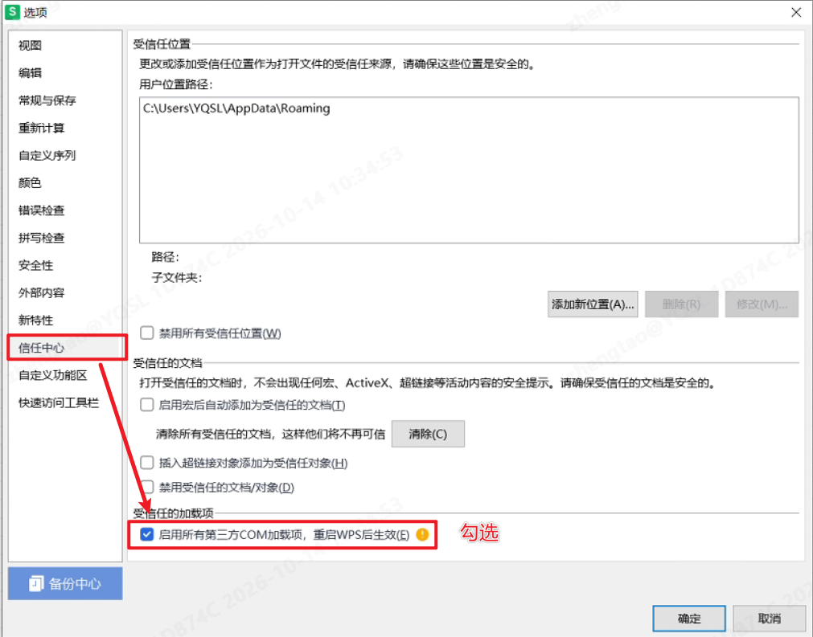
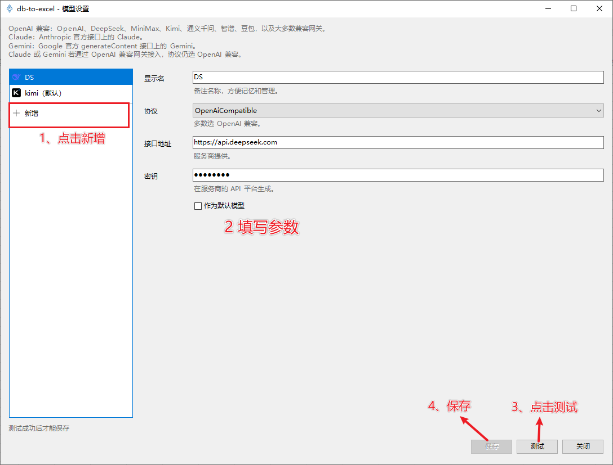
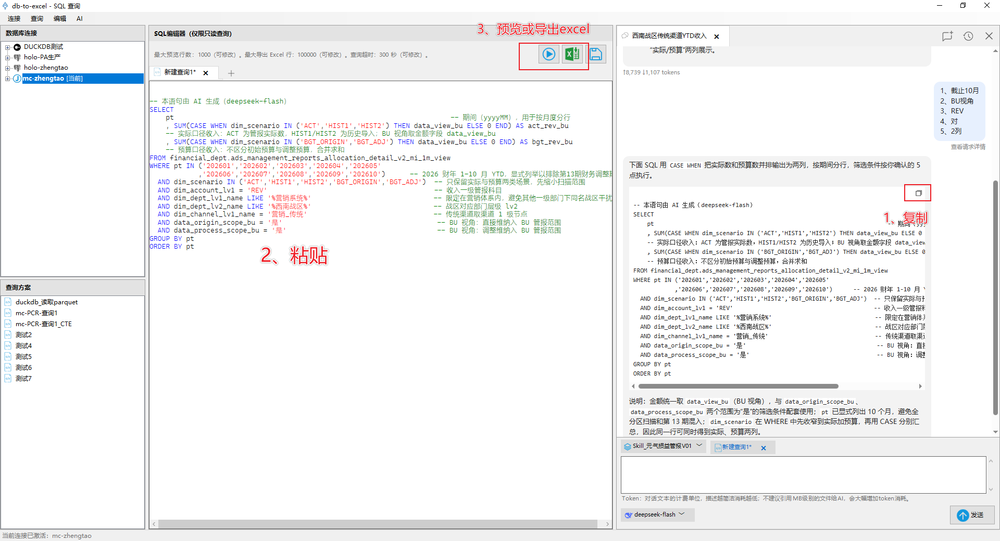
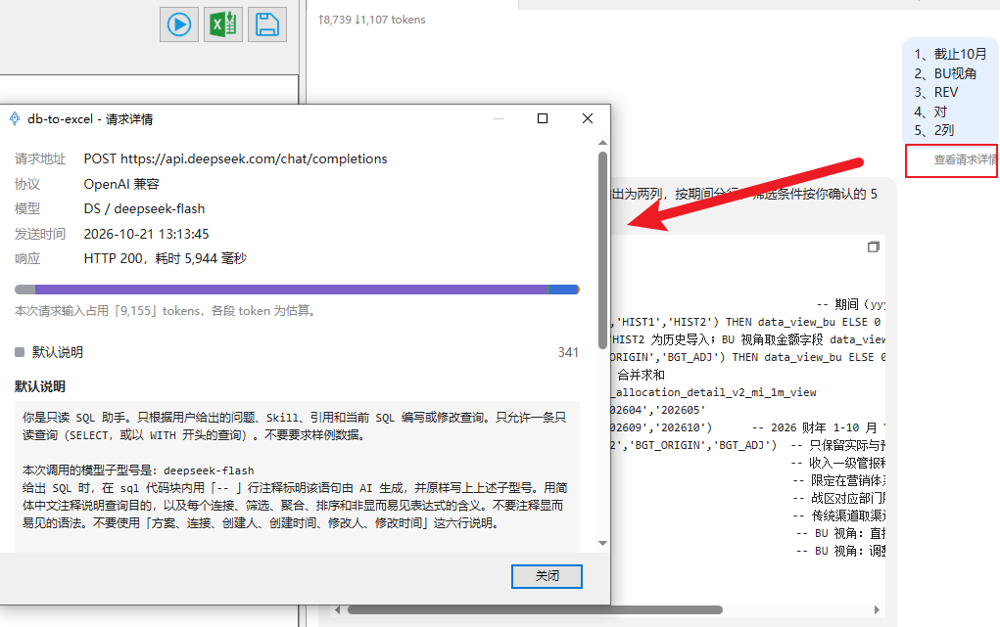

**🔥 痛点**

数分和报表岗日常最枯燥的重复劳动：打开 DBeaver/Navicat → 跑 SQL → 导出结果 → 复制粘贴进 Excel，当Excel底稿涉及多个 Sheet更新时，搬运数据的耗时尤其巨大。

**⚡ db-to-excel 是什么**

db-to-excel 是嵌入 Windows  Excel / WPS 表格的插件，在表格内部直接执行 SQL，把数据库查询结果写入工作表。插件只负责【数据库到工作表的数据同步】，保留原有的 Excel 生态：公式、透视表、图表、看板不需重构。定期报表更新不再依靠手工搬运数据。

**🤖 AI 助手：说需求，出 SQL**
内置 AI 助手，用自然语言描述需求即可生成只读 SQL，不用再手写复杂查询。
- **不限制 API**：模型自由配置，想用哪家用哪家。
- **支持Skill注入业务知识**：把表结构、字段含义、业务口径写成 Skill，生成的 SQL 才贴合你的库。
- **只是 ASK 模式**：AI 只对话，绝不操作你的电脑，绝不读取数据库连接和连接信息。

**🎬 批量更新功能演示**

# 快速开始

## 1、安装

- 先关闭并退出 Excel 和 WPS。
- 下载并运行安装包（2选1，国内选Gitee）：
  - GitHub：[db-to-excel.exe](https://github.com/GouMaoMao/db-to-excel/releases/latest/download/db-to-excel.exe)
  - Gitee：打开 [Releases](https://gitee.com/GouMaoMao/db-to-excel/releases)，下载安装 `db-to-excel.exe`。
- 打开 Excel 或 WPS，菜单栏出现「db-to-excel」选项卡即表示安装成功。

> 安装包未签名，Windows 可能提示不安全，请放心放行。（可以让AI审查代码安全性） 
> 如果菜单栏没出现「db-to-excel」，设置下信任加载项： 

## 2、新建连接

- 打开 Excel 或 WPS 表格，顶部菜单—>「db-to-excel」—>「连接管理」—>「新建」
- 选择数据源类型。
  > 内置支持 SQL Server、MySQL、PostgreSQL、SQLite、DuckDB。 也可选用 JDBC 通用连接，需本机装Java环境，并准备对应数据库的 `.jar` 驱动文件。针对阿里云MaxCompute数仓，使用JDBC连接，详见：[阿里云 MaxCompute JDBC 连接配置](docs/JDBC_MAXCOMPUTE.md)
- 根据选中的数据源类型，依次填写服务地址、数据库（或文件路径）、账号密码等连接信息。
- 点击「测试连接」验证连通性；测试成功后，填写显示名称（自定义备注，方便后续识别）。
- 测试通过后点「保存」。

## 3、批量刷新（多 SQL 批量拉取数据）

### 3.1、 参数准备

- 在工作簿里准备一张名为 SQL 的工作表，按下面规范编写查询脚本：
  - 第 1 行填写目标输出工作表名称
  - 从第 2 行开始，编写完整 SQL 查询语句，一列对应一个独立查询。

> 效果：每一列的 SQL 执行完成后，查询结果自动写入对应Sheet。
> SQL代码随工作簿一起保存和复用，适合需要定期更新的底稿或报表。

### 3.2、 刷新步骤

打开功能区「批量刷新」，在左边设置刚保存的连接为当前连接，勾上要更新的列，点窗口里的「批量刷新」。

## 4、单次查询

- 点击顶部功能区「SQL 查询」，打开查询面板。
- 输入 SQL 查询语句，支持先预览结果，确认无误后写入指定工作表。
  > 查询方案可保存复用
  

## 5、AI 助手（生成 SQL）

### 5.1、配置模型

- 打开顶部菜单「db-to-excel」—>「设置」—>「AI 设置」—>「模型设置」，点击左侧列表末尾的「新增」。
- 填写显示名、协议、接口地址和密钥。具体怎么获取见大模型厂商的API说明文档。
- 点击「测试」，测试通过后点击「保存」。
- 需要默认使用该模型时，保存前勾选「作为默认模型」。
> 可自由配置多个模型，在对话时随时切换。

### 5.2、配置 Skill（必配）

- 打开顶部菜单「db-to-excel」—>「设置」—>「AI 设置」—>「Skill 设置」，点击左侧列表末尾的「新增」或者底下「导入」按钮。
- 点击「保存」。

> - Skill 必须配置。AI 看不到你的数据库有哪些表和字段，不配 Skill 时它只能猜，生成的 SQL 几乎没法用。Skill 写得越准确，生成的 SQL 越可用。
> - 建议由了解对应库表逻辑的数据分析人员编辑好介绍该库表知识文档(表结构、字段含义、口径说明、常用筛选条件等等)，作为skill。

### 5.3、用 AI 生成 SQL

- 打开「SQL 查询」，点击菜单栏的「AI」，窗体右侧展开对话栏。
- 在输入框下方选择模型，在输入框上方选择要用的 Skill。可多选。
- 描述需求，按 Enter 发送，Shift+Enter 换行。
- 复制AI回复中 SQL 代码块，粘贴到左侧 SQL 编辑器，点击「预览」，或点击「写入 Sheet」把结果写入工作表。

### 5.4、关于数据安全
-  **AI助手只是ASK模式。** 它只返回文字和 SQL，由你自己复制；他不操作你的电脑，不执行 SQL，也不改动你的查询。
-  AI助手不读取数据库连接和连接信息，只有你用 `@` 主动附上的内容才会发送给大模型。
-  可跟踪查看每次对话传送给大模型的内容。

## 技术信息

- 运行环境：Windows 环境，依赖 .NET Framework 4.7.2
- 架构说明：详见文档 [docs/ARCHITECTURE.md](docs/ARCHITECTURE.md)
- 数据库连接配置、查询方案、运行日志均保存在本机目录： `%LocalAppData%\DB2Sheet`。
  > 说明：该目录仅存放本地配置与日志，不会上传数据库账号、查询数据至外部服务器。
  > 仅在使用 AI 对话时，才会把你的问题、当前 SQL、所选 Skill 和 `@` 引用的内容发给你自己配置的模型服务商；数据库连接地址、账号密码和查询结果行不会发送（除非你用 `@` 附上预览）。

