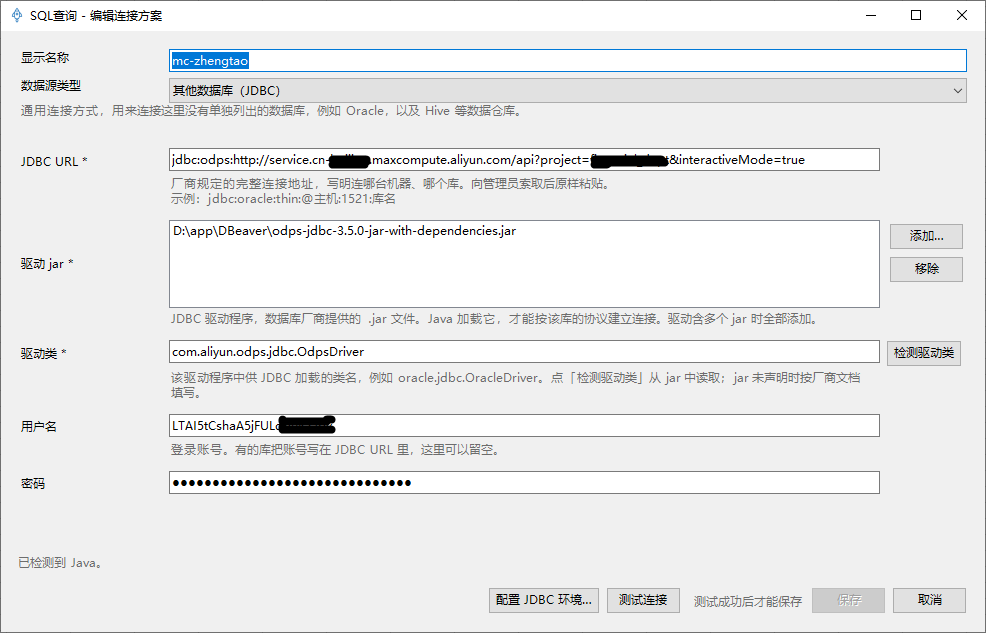

# 阿里云 MaxCompute JDBC 连接配置

## 1 前置准备

- 申请AccessKey ID、AccessKey Secret（向系统管理员了解申请流程）
- 申请对应的MaxCompute项目访问权限（向系统管理员了解申请流程）

## 2 新建连接

1. 打开 Excel / WPS，顶部菜单「SQL 查询」→「连接管理」→「新建」
2. 数据源类型选择：JDBC

> 如果提示缺少JDBC环境，按照提示一步步安装即可

1. 填写连接参数：

- **JDBC URL**。示例：`jdbc:odps:http://service.cn-beijing.maxcompute.aliyun.com/api?project=financial_dept&interactiveMode=true`

| 参数                 | 是否必填 | 说明                           |
| ------------------ | ---- | ---------------------------- |
| Endpoint           | ✅ 必填 | MaxCompute 对应地域服务地址，按项目所在地选择 |
| project            | ✅ 必填 | MaxCompute 项目名称              |
| interactiveMode    | ⭕ 可选 | `true` 开启交互式查询加速             |
| useProjectTimeZone | ⭕ 可选 | `true` 服务端时区对齐               |

- **驱动jar**。下载[odps-jdbc-3.9.0.jar](https://help-static-aliyun-doc.aliyuncs.com/file-manage-files/zh-CN/20250106/jgionw/odps-jdbc-3.9.0-rc4-jar-with-dependencies.jar?spm=a2c4g.11186623.0.0.739d70a2tkwLr8&file=odps-jdbc-3.9.0-rc4-jar-with-dependencies.jar)，然后[添加]
- **驱动类**。点击「检测驱动类」，自动生成`com.aliyun.odps.jdbc.OdpsDriver`
- **用户名**。AccessKey ID
- **密   码**。AccessKey Secret
  > 此处的用户名、密码**不是阿里云登录邮箱 / 账号密码**，是专门为 API 访问单独申请的 AccessKey。
- **显示名称**。自定义备注（例：`MaxCompute-杭州数仓-张三账号`）
- **测试连接**，连通成功后，保存并关闭窗口。接下来，可正常使用SQL查询或批量刷新功能。

## 阿里云官方文档参考

[通过数据库管理工具连接MaxCompute](https://help.aliyun.com/zh/maxcompute/compatibility-overview?spm=a2c4g.11186623.0.i1)